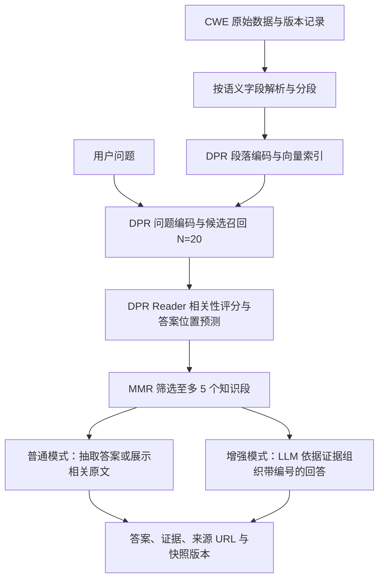

# BOO-Graduation-Project

**本科毕业设计：基于检索增强与证据筛选的网络安全问答系统设计与实现**

*The Design and Implementation of a Cybersecurity Question Answering System Based on Retrieval Augmentation and Evidence Selection*

本仓库以[开题报告整理版](docs/开题报告_整理版.md)为当前研究依据，面向公开安全知识查询，建设能够展示答案、证据原文和来源的问答系统。优先使用 CWE，复用已有 DPR、DPR Reader 与 MMR 基线，完成安全数据适配、双模式系统、界面及实验评估。

## 技术路线



- **知识库：** 优先处理 CWE 英文原文，保留条目 ID、字段、来源 URL、获取时间、版本与知识段 ID；NVD 等作为可选扩展。
- **召回与评分：** DPR 初始召回 20 段，Reader 输出相关性分数及答案起止位置。英文模型优先配套英文核验问题，中文支持需另行验证。
- **证据筛选：** MMR 使用统一尺度后的 Reader 相关性与段落向量余弦相似度，默认选 5 段，候选不足时返回实际数量；λ 只在开发集选择。
- **双模式：** 普通模式复用 Reader 抽取结果，必要时展示相关原文；增强模式基于同一组选定证据生成带证据编号的回答。证据不足时提示无法确认。
- **知识更新：** 计划支持手动触发与定期检查，按条目和内容哈希识别变化，同步更新知识段和索引，通过一致性检查后启用新版本并保留回退版本；正式实验固定快照。


## 当前状态

截至 2026-11-12，仓库处于**基础代码与实施规划阶段，尚无完整问答系统或正式实验结果**。

| 内容 | 当前状态 |
| --- | --- |
| 开题报告、技术路线图与研究范围 | 已整理并同步 |
| Python 包、Evidence 数据结构、证据基础指标 | 已有最小实现 |
| 安全 ID 解析、DSES、合成示例及 6 项测试 | 早期探索，保留供参考；不代表当前主线已实现 |
| 原始安全数据与校验脚本 | 本地有起始快照；Git 仅保存来源、哈希和脚本 |
| CWE 解析分段、知识库更新与索引构建 | 待实现 |
| DPR 召回、Reader、MMR 和 Reader Top-5 对照 | 待接入或实现 |
| 普通／增强回答、来源展示与交互界面 | 待实现 |
| 至少 120 题人工核验集与受控实验 | 待完成 |

## 目录结构

以下均为仓库中的实际路径；标为“规划”的目录目前仅含职责说明。

```text
.
├─ README.md
├─ CONTRIBUTIONS.md             # 前期基础与个人工作边界
├─ pyproject.toml               # Python >= 3.10；当前核心仅用标准库
├─ configs/
│  ├─ README.md
│  ├─ baseline.example.json     # 新主线配置草案，尚未接入执行器
│  └─ dses.example.json         # 早期探索配置
├─ data/
│  ├─ README.md                 # 知识段、版本与更新规范
│  ├─ SOURCES.md                # 本地快照来源和下载说明
│  ├─ starter_snapshot_2026-10-20.sha256
│  ├─ raw/                     # 原始数据，Git 仅保留占位文件
│  ├─ processed/               # 知识段、清单和索引，生成物不提交
│  └─ annotations/             # 人工核验与按条目划分规范
├─ docs/
│  ├─ README.md
│  ├─ 开题报告_整理版.md
│  ├─ 研究范围.md
│  ├─ figure1.png
│  └─ figure2.jpeg
├─ experiments/                # 对照实验、指标和运行记录规范
├─ outputs/                    # 生成结果与图表，默认不提交
├─ scripts/                    # 原始数据校验与早期 DSES 示例
├─ src/cyber_qa/
│  ├─ README.md                 # 已实现能力和后续模块边界
│  ├─ data/                    # 现有 Evidence 结构；CWE ETL 待实现
│  ├─ retrieval/               # 现有 ID 解析；DPR 召回待接入
│  ├─ reader/                  # 规划：Reader 评分与答案位置
│  ├─ selection/               # 现有 DSES；MMR、Reader Top-5 待实现
│  ├─ answering/               # 规划：共享证据的普通／增强回答
│  ├─ pipeline/                # 规划：统一问答链路与追溯记录
│  └─ evaluation/              # 现有证据指标；完整评价待实现
├─ app/                        # 规划：问题输入、模式切换与证据展示
└─ tests/                      # 现有基础模块测试
```

模块职责见 [src/cyber_qa/README.md](src/cyber_qa/README.md)，配置边界见 [configs/README.md](configs/README.md)。

## 基础代码验证

在仓库根目录使用 **Python 3.10 或更高版本**创建独立环境。以下为 Windows PowerShell 示例（本次验证使用 Python 3.12）：

```powershell
py -3.12 -m venv .venv
.\.venv\Scripts\python.exe -m pip install -e ".[dev]"
.\.venv\Scripts\python.exe -m pytest -q
.\.venv\Scripts\python.exe scripts\smoke_demo.py
```

`smoke_demo.py` 仅运行早期 DSES 的合成数据示例，不执行 DPR、MMR 或真实问答。当前没有可启动的 Web 应用。模型与索引依赖将在模块接入时确定，当前无需下载模型。

本地具备完整起始快照时，可运行下列校验；新克隆仓库不含原始数据，须先按[数据来源说明](data/SOURCES.md)准备文件：

```powershell
.\.venv\Scripts\python.exe scripts\validate_raw_data.py
```

## 实验计划

至少建立 **120 道人工核验题**，按 CWE 来源条目划分开发集 80 题和冻结测试集 40 题，避免同一条目跨集。覆盖定义、后果、检测与缓解，标记单跨度题与综合题。

| 对照 | 控制条件 | 主要观察 |
| --- | --- | --- |
| Reader Top-5 与 MMR | 相同 DPR 候选池、Reader 分数、模型与知识库快照 | Evidence Recall@5、有效知识段比例、冗余与实际返回段数 |
| 普通模式与增强模式 | 相同 MMR 证据集合及顺序 | 关键事实正确性、完整性、来源支持、无依据陈述及端到端开销 |

检索报告 Recall@N；有标准跨度的子集补充 EM/F1。分别记录召回、Reader、筛选和回答耗时，以及资源使用。参数、提示词和模型配置只在开发阶段确定，正式测试冻结；不预设 MMR 或增强模式必然更好。详见[实验规范](experiments/README.md)。

## 实施安排

| 时间 | 计划成果 |
| --- | --- |
| 2026 年 10—11 月 | 技术路线、文献与开题材料 |
| 2026 年 12 月 | CWE 解析分段、来源与版本规范、知识库更新机制 |
| 2027 年 1 月 | DPR、Reader、MMR 与普通问答链路 |
| 2027 年 2 月 | 增强模式、界面、核验数据集与冻结配置 |
| 2027 年 3 月 | 受控实验、错误分析与论文初稿 |
| 2027 年 4—5 月 | 评阅修改、必要补充实验、答辩及归档 |

## 文档与贡献

- [文档导航](docs/README.md) · [开题报告](docs/开题报告_整理版.md) · [研究范围](docs/研究范围.md)
- [数据规范](data/README.md) · [标注规范](data/annotations/README.md) · [实验规范](experiments/README.md)
- [个人贡献与复用边界](CONTRIBUTIONS.md)

`QORE-VLM` 是前期项目参考，拟复用的基础为 DPR 编码、Reader 评分和 MMR 接口；接入时需核对输入、分数、段落顺序与返回格式，记录来源版本。安全数据适配、双模式集成、界面、溯源及实验评价属于本课题计划工作，完成情况以代码和运行记录为准。

原始数据、模型、环境文件与生成物不随仓库上传。数据需记录官方来源、版本、哈希及使用条款；问题和支持证据须经人工核验，引用编号有效不等于事实已被验证。
