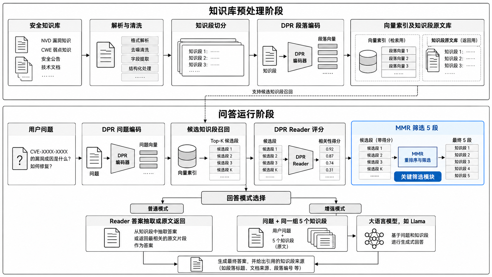
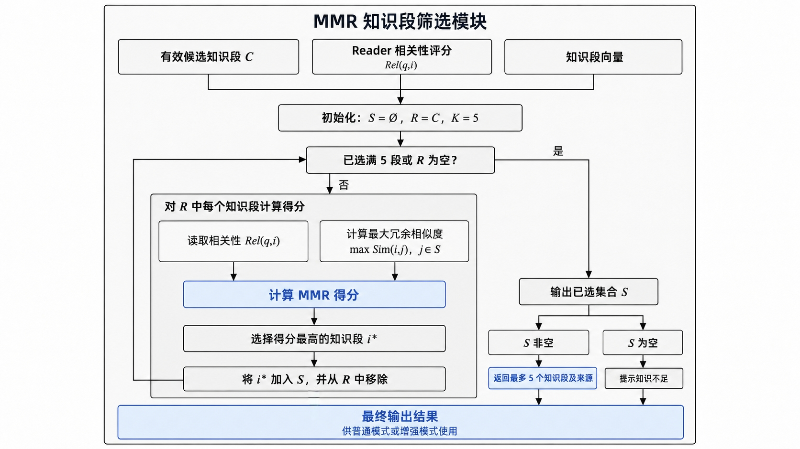

# 中国传媒大学毕业论文（设计）开题报告表

| 学生姓名 | 李俊豪 | 学号 | 202312063053 | 班级 | 23网安2班 |
| --- | --- | --- | --- | --- | --- |
| 教师姓名 | 王静涛 |  |  |  |  |
| 毕设题目 | 基于检索增强与证据筛选的网络安全问答系统设计与实现 |  |  |  |  |

## 一、研究背景和研究意义

随着数字基础设施规模扩大，漏洞排查、产品安全评估与日常安全运营需要准确、可更新的专业知识。NVD、CWE、MITRE ATT&CK 和 CAPEC 分别组织漏洞记录、弱点类型、攻击技术与攻击模式等公开资源[1-4]。这些资料具有标准编号和原始出处，为建设面向安全领域的知识问答系统提供了数据基础。

在实际查询中，用户往往希望了解某类弱点的定义、产生原因、可能后果及缓解方式。人工查阅长篇条目需要反复定位相关段落，单纯按关键词或相关度返回的结果又可能存在重复。本课题面向公开安全知识查询，将现有问答基线落地为一个可展示证据和来源的应用系统，帮助用户查找知识并核对回答依据。

大语言模型具备自然语言回答能力，但其参数知识可能不包含特定安全条目的最新信息。检索增强生成（Retrieval-Augmented Generation, RAG）将外部知识段作为回答依据[5,6]。本课题沿用已有基线流程，先使用稠密段落检索（Dense Passage Retrieval, DPR）召回安全知识段，再由 DPR 阅读器（DPR Reader）对候选知识段进行评分，随后通过最大边际相关性（Maximal Marginal Relevance, MMR）筛选至多 5 段知识，供回答模块使用。

系统提供普通模式与大语言模型增强模式。普通模式依据筛选结果抽取答案片段，并展示对应原文与来源；增强模式将同样的至多 5 段知识交给所选大语言模型，组织为带证据编号的自然语言回答。两种模式共享知识库、召回和筛选过程，使用户可以在回答组织能力、响应速度和资源开销之间进行选择。

通过本课题对网络安全知识检索、知识段筛选与双模式问答的研究，能够为安全知识的高效获取、回答依据的追溯与核验提供技术支撑。在理论意义上，有助于分析知识相关性与冗余程度对问答质量的影响，为检索增强方法在网络安全领域的适用性研究提供实验依据；在应用意义上，有助于降低安全知识查询与资料整合的成本，为网络安全学习、弱点分析和防护措施查询等场景提供辅助。

## 二、国内外发展现状

在检索与段落组织方面，Carbonell 等于 1998 年提出 MMR，通过相关性与新颖性之间的权衡减少结果重复[7]。2020 年 Karpukhin 等提出 DPR，用问题编码器和段落编码器形成稠密表示，以支持开放域问答中的知识段召回[8]。DPR Reader 则读取问题和已召回的段落，输出知识段相关性及答案位置。两者分别承担检索与阅读评分任务，为本课题的普通问答和选证过程提供基础。

2020 年 Lewis 等将检索器与生成模型结合提出 RAG[6]，2021 年 Izacard 等进一步研究多段知识的生成式融合[9]。这些工作表明，可以先从外部语料获得候选知识，再利用生成模型组织回答。本课题据此使用既有 DPR—Reader—MMR 基线，而将工程工作集中于安全语料处理、模块连接和结果溯源。MMR 的相关性与冗余权衡参数将在开发集选择，测试阶段保持固定。

2024 年的 Self-RAG、Adaptive-RAG 和 CRAG 分别从自我反思、问题复杂度及纠错检索角度研究检索增强流程[10-12]。这些研究拓展了 RAG 的组织方式，也说明复杂流程可能增加训练或推理开销。本课题采用结构清晰的基线作为应用基础，主要检验 MMR 对重复知识段的控制，以及加入大语言模型后的答案质量和资源变化。

前期项目中的 DPR 编码、DPR Reader 相关性评分和 MMR 基线可为本课题提供可复用接口。复用时需要核对模型输入、分数含义、段落顺序及返回格式，保证安全知识段能够进入同一条问答链路。个人工作为安全领域数据适配、双模式系统实现、界面与证据展示以及实验评估。

在答案可信性方面，2023 年 Gao 等研究带引用文本生成，Min 等提出 FActScore，将事实评价细化到原子事实[13,14]。2024 年 RAGAs、ARES、RAGBench 提供检索增强系统评测思路，长上下文研究讨论知识位置对模型使用的影响[15-18]。这些工作提示，评测应同时关注答案正确性、引用支持和处理开销，而不能只依据回答是否流畅作出判断。

本课题据此分别评价检索、筛选与回答阶段。检索阶段检查必要知识是否进入候选集；筛选阶段检查最终至多 5 段中有多少有效知识及重复内容；回答阶段核对事实与原文是否一致。普通模式主要观察抽取答案的准确性与相关知识段可用性，增强模式进一步观察回答完整性、引用支持和无依据陈述。

网络安全领域已有相应基准与系统研究。SecQA、CyberMetric 与 CTIBench 为安全知识和威胁情报问答提供题型参考[19-21]；国内网络安全大模型与威胁情报综述总结了应用现状[22,23]。2025 年 LEAD-Cyber 探索垂域模型构建，2026 年林等提出安全领域 RAG 系统架构[24,25]。Llama 3 系列模型可作为本课题生成端的一个选型示例[26]。这些工作支持安全知识问答的应用方向，但不能替代本课题在指定知识库和实际运行条件下的验证。

综上，本课题将任务收敛为一个安全领域的基线应用：构建可追溯知识库，完成 DPR 知识段召回与 Reader 相关性评分，使用 MMR 筛选至多 5 段，并实现普通和增强两种回答模式。拟回答的问题是：该流程能否正确找到安全知识、MMR 相较直接取高分段能否降低重复、两种回答模式在正确性和运行开销上有何差异。上述问题通过统一数据和受控实验形成验证闭环。

## 三、研究目标与研究内容

本课题旨在设计并实现基于检索增强与证据筛选的网络安全问答系统，面向公开安全知识提供知识查询、双模式问答和来源追溯功能，支持知识库持续更新。系统采用基于 DPR 双编码器的检索器召回候选知识段，使用 DPR Reader 阅读模型进行段落相关性评分与答案位置预测，并通过 MMR 算法筛选回答证据，重点研究安全知识组织、知识段检索与筛选、共享证据的双模式问答及系统评价，完成相关方法在网络安全场景中的适配、集成与验证。主要研究内容如下：

**（1）面向网络安全条目的知识库构建。** 优先使用 CWE 数据，将弱点定义、常见后果、检测与缓解措施等内容解析并切分为知识段，保留条目编号、语义字段、来源链接和版本信息。结合安全条目的结构特点组织知识段，尽量保持术语解释与相关描述的语义完整性，建立知识段与原始条目的对应关系，为后续检索和回答来源追溯提供支撑；NVD 等来源作为后续可选扩展。

**（2）基于 DPR 与 MMR 的知识段检索与筛选。** 使用 DPR 段落编码器生成知识段向量并建立索引，通过 DPR 问题编码器生成问题向量，召回候选知识段，再由 DPR Reader 进行相关性评分。在此基础上，采用已有 MMR 方法，综合问题相关性与知识段间冗余，默认选取 5 个知识段作为回答证据，候选不足时返回实际数量。结合安全术语查询、弱点解释和缓解措施查询等题型，分析该流程对相关知识获取与重复信息控制的作用。

**（3）共享证据的双模式问答与来源展示。** 设计普通模式与增强模式共享同一组选定知识段的问答流程。普通模式利用 DPR Reader 抽取答案，无法通过单一答案片段充分回答时返回相关原文；增强模式使用大语言模型（例如 Llama 系列模型）依据相同知识段组织回答。完成问题输入、模式切换、答案与来源展示等功能，建立回答内容与支撑知识段之间的对应关系，为用户提供便于核验的查询结果，并分析两种模式在不同问题类型和资源条件下的适用性。

**（4）面向检索、筛选与回答全过程的实验评价。** 构建人工核验的网络安全问答测试集，在相同候选知识段集合下，对比按 DPR Reader 评分选取前 5 段与采用 MMR 筛选的效果；在相同选定知识段下，对比普通模式与增强模式的回答表现。从知识段召回、证据相关性与冗余程度、回答正确性与完整性、来源支持和运行开销等方面开展评价，分析知识段筛选对回答质量的影响，形成可复现的数据处理流程、实验配置和运行记录。

## 四、技术路线与研究方法

系统按照知识库预处理和问答运行两个阶段组织。知识库预处理阶段将安全条目解析并切分为知识段，保存来源等元数据，使用 DPR 段落编码器生成知识段向量并建立索引。问答运行阶段在用户输入问题后，先由 DPR 问题编码器生成问题向量并召回候选知识段，再由 DPR Reader 进行相关性评分，随后由 MMR 默认选取 5 个知识段，最后由回答模块按普通模式或增强模式输出结果。两个模式共享同一组选定知识段；DPR 负责召回，DPR Reader 负责阅读评分及答案抽取，MMR 负责筛选，大语言模型负责增强模式的回答组织。系统总体流程如图 1 所示。

*图 1：网络安全知识问答系统总体技术路线*

在研究方法上，本课题采用系统设计与实现、对照实验和人工核验相结合的研究思路，以网络安全知识问答为应用场景，围绕知识段召回、相关性评分、去冗余筛选及证据支持的答案生成开展研究。首先，采用结构化解析与分段方法构建可追溯的安全知识库，加载已有训练权重，使用 DPR 段落编码器生成知识段向量并建立索引，使用 DPR 问题编码器对用户问题进行编码并召回候选知识段，再由 DPR Reader 对问题与候选知识段进行联合阅读，输出段落相关性分数及答案起止位置分数；其次，引入最大边际相关性（MMR）算法，在兼顾问题相关性与知识段间冗余的基础上在预设数量上限内筛选回答证据；随后，分别构建基于 Reader 答案抽取的普通模式和基于大语言模型的增强模式，实现同一证据集合下的两种回答方式；最后，采用控制变量的对照实验方法，从检索效果、证据筛选质量、回答正确性、来源支持情况及运行开销等方面进行综合评价，并结合人工核验与典型失败案例分析验证系统的有效性和适用边界。具体研究方法如下。

### （1）安全知识库与知识段构建

优先使用已获取的 CWE 数据构建系统初始知识库，围绕弱点定义、成因、后果及缓解等有原文依据的题型设计问答。解析时保留条目 ID、字段名、原文、来源 URL、数据版本、获取时间及知识段 ID。先按语义字段切分，再对超长字段依据模型输入长度限制进行二次切分，尽量保留完整句子、安全编号及必要的上下文。预处理包括编码与空白规范化、重复记录识别等操作，保持来源事实和适用条件。

为支持知识库持续更新，设计定期检查与手动触发相结合的更新机制，通过条目 ID、字段内容及哈希比较识别新增、修改和状态变化的数据。对新增或修改内容重新解析、切分并生成段落向量，同步更新原文、来源信息和向量索引，使失效知识段退出当前检索范围。更新过程保留版本记录与处理日志，在待启用版本通过一致性检查后切换使用，并保留上一有效版本以支持回退。

日常查询采用最近一次更新成功的知识库版本，并记录每次问答所使用的数据版本。正式实验固定知识库快照、处理脚本和模型配置，记录相应版本与哈希，以保证对照实验的一致性和可复现性。后续扩展 NVD 时，另行记录数据范围，并根据其数据接口设计相应的增量获取与更新流程。

### （2）DPR 知识段召回与 DPR Reader 相关性评分

在知识库预处理阶段用 DPR 段落编码器计算知识段向量，在用户输入问题后用 DPR 问题编码器计算问题向量，按向量匹配分数取前 N 段，初始 N 设为 20。随后把问题与各候选知识段输入 DPR Reader，取得知识段相关性评分，供 MMR 使用；Reader 的答案起止位置也服务普通模式。DPR 检索器负责从知识库中召回候选知识段，DPR Reader 负责对问题与候选段落进行联合阅读，输出段落相关性分数及答案起止位置分数。模型版本、分词器、截断长度及 N 在开发阶段确定后冻结。优先使用与既有 DPR 英文模型匹配的英文原文和核验问题；中文查询支持如需加入，应单独验证，不预设中英文效果相同。

### （3）MMR 知识段筛选

给定候选集合 C、问题 q 与已选集合 S，MMR 每轮选择兼顾问题相关性和新增信息的候选知识段。问题相关性使用 DPR Reader 的知识段相关性评分，经统一尺度处理；冗余使用候选知识段向量的余弦相似度。S 为空时冗余项为 0，之后逐轮计算与已选段的最大相似度，并更新 S。其基本选择形式如下：

$$
R(i,S)=
\begin{cases}
0, & S=\emptyset,\\[2pt]
\max_{j\in S}\operatorname{Sim}(i,j), & S\neq\emptyset,
\end{cases}
$$

$$
\operatorname{MMR}(i\mid q,S)=\lambda\,\operatorname{Rel}(q,i)-(1-\lambda)\,R(i,S) \qquad (1)
$$

式中 $\operatorname{Rel}(q,i)$ 为候选知识段对问题的相关性，$\operatorname{Sim}(i,j)$ 为知识段间相似度，$0\leq\lambda\leq 1$ 控制相关性与去冗余的权衡。每轮从 C 中未选知识段选择得分最高者，直到选满 5 段。候选知识段不足 5 段时返回实际数量。证据充分性结合相关性评分及答案支持情况另行判断，具体判定规则在开发阶段确定。对于空候选集或证据不足的问题，返回提示或相关原文，并在实验中核验处理是否恰当。系统通过预处理分段和输入长度检查保证 5 段可装入所选大语言模型的上下文，长度只作为工程约束，不另设新的领域评分或优化目标。图 2 给出评分、筛选和双模式回答的具体衔接。

*图 2：DPR Reader 相关性评分与 MMR 知识段筛选及回答流程*

### （4）普通模式与大语言模型增强模式

普通模式面向希望快速获取原始信息、控制计算开销的用户，适用于弱点定义、局部事实和具体措施等查询。系统复用候选阅读阶段获得的 DPR Reader 答案位置及评分，在 MMR 选出的最多 5 个知识段内选择候选答案，返回原文片段及其来源，并支持展开相关上下文。对于难以通过单个答案跨度充分回答的问题，展示相关原文段落和出处。该模式保留原文措辞，省去生成式大模型调用，预期能够降低在线问答的响应时间和生成阶段资源开销，具体效果通过实验测量。

大模型增强模式面向需要解释、归纳和多段信息整合的用户，将问题和同一组筛选后的知识段按证据编号输入大语言模型，由模型依据资料组织自然语言回答，并标注对应来源。该模式允许在保留原意和必要适用条件的基础上，对原文进行改写与整合，以提高回答的可读性和完整性。证据不足时要求说明无法确认。具体模型根据任务适配性与运行资源选择，模型权重、精度、提示词及解码参数在正式实验前固定。系统向用户说明两种模式在输出形式和资源使用上的差异，由用户根据查询需求与资源偏好选择。

### （5）系统功能与来源追溯

原型提供问题输入、回答模式切换、答案展示和证据展开。每条证据展示安全条目 ID、字段、原文、URL 与快照版本，用户可回查出处。系统保存问题、候选知识段与 Reader 相关性评分、MMR 选择顺序、最终 5 段及回答，保证界面和实验共用同一处理链路。对答案中的引用编号进行有效性检查，并通过人工抽样核对引用是否真正支持结论；引用存在不等于事实已被验证。

### （6）实验设计与评价指标

构建至少 120 道人工核验安全问答题，按条目划分开发集 80 题和冻结测试集 40 题，覆盖定义、后果、检测与缓解等有依据的任务。保留问题、可接受答案、必要事实及支持段落 ID，单独标记单跨度可回答题和需要多个段落的综合题。对比直接按 Reader 相关性评分取前 5 段与 MMR 选 5 段，固定相同候选池与模型；再在同一组 MMR 证据上比较普通模式与增强模式。参数只在开发集选择，不预设 MMR 筛选或大语言模型增强回答必然更好。

检索层报告 Recall@N；筛选层报告 Evidence Recall@5、有效知识段比例、平均知识段间相似度及实际返回段数；回答层报告人工核验的关键事实正确性、回答完整性、来源支持情况和无依据陈述比例。对有标准跨度答案的子集补充 EM/F1，综合题以事实与证据核验为主，避免用同一跨度指标评价所有题目。分别记录召回、Reader 相关性评分、MMR 和回答耗时，比较两种模式的端到端延迟与资源使用。失败案例区分数据缺失、召回遗漏、Reader 相关性评分偏差、MMR 漏选、抽取失败和生成误用。

### （7）可行性与实施边界

CWE 等公开资源提供机器可读数据、条目编号与可回查出处，前期项目提供的 DPR 编码、Reader 相关性评分及 MMR 基线接口可作为系统集成基础。知识库构建阶段的计算开销主要涉及知识段编码与索引构建。在初始候选数 N＝20、最终最多选择 5 个知识段的设置下，MMR 的额外计算开销预计较小。在线问答阶段需重点评估 DPR 问题编码与检索、Reader 推理，以及增强模式下的大语言模型生成开销，其中 Reader 推理和大语言模型生成预计占比较高，具体通过实验测量确定。拟先完成小规模语料处理与普通模式，再接入所选大语言模型并开展受控实验。若硬件或数据适配造成延期，优先完成一个安全知识库、完整的 DPR—Reader—MMR 流程、120 题核验集及两种模式的可复现实验，将实施范围控制在现有方法的适配与验证之内。

## 五、论文工作安排

**表 1　毕业论文（设计）月度工作安排**

| 时间 | 核心工作 | 阶段性成果 |
| --- | --- | --- |
| 2026年10月—11月 | 确认安全领域基线应用范围；研读 DPR、Reader、MMR 与安全问答文献，修订开题。 | 技术路线、文献清单与开题材料 |
| 2026年12月 | 固定 CWE 数据版本，制定知识段切分、编号及来源记录规范；完成数据解析、知识段构建与样例核验以及实现数据库可更新化。 | 安全知识段、数据字典与版本清单 |
| 2027年1月 | 建立 DPR 知识段向量索引与候选召回接口，接入 DPR Reader 相关性评分；完成 MMR 默认筛选 5 个知识段的流程及普通模式回答。 | 可运行的召回、评分、筛选与普通问答模块 |
| 2027年2月 | 接入大语言模型增强模式，实现模式切换、答案与来源展示；完成人工核验问答集，按来源条目划分开发集与测试集，利用开发集调参并固定实验配置。 | 双模式系统原型、问答数据集与实验配置 |
| 2027年3月 | 完成 DPR Reader Top-5 与 MMR 筛选、普通模式与增强模式的对照实验；分析回答质量、来源支持、延迟与资源开销，完成错误分析和论文初稿。 | 实验结果、典型案例、论文初稿与中期检查材料 |
| 2027年4月 | 根据导师意见修改论文，按学院要求完成中期检查并提交交叉评阅；依据评阅意见补充必要实验、完善论文和系统演示，准备答辩材料。 | 交叉评阅稿、评阅意见修改记录与答辩材料 |
| 2027年5月 | 按学院安排于中上旬完成答辩；根据答辩意见修改论文，整理代码、数据版本、实验配置及运行记录，完成材料提交与归档。 | 论文终稿、答辩材料、系统代码与实验复现材料 |

## 参考文献

[1] National Institute of Standards and Technology. NVD Data Feeds[EB/OL]. [2026-10-29]. https://nvd.nist.gov/vuln/data-feeds.

[2] MITRE. CWE Downloads[EB/OL]. [2026-10-29]. https://cwe.mitre.org/data/downloads.html.

[3] MITRE. ATT&CK Data & Tools[EB/OL]. [2026-10-29]. https://attack.mitre.org/resources/attack-data-and-tools/.

[4] MITRE. CAPEC Downloads[EB/OL]. [2026-10-29]. https://capec.mitre.org/data/downloads.html.

[5] 李子骏, 肖辉, 李雪峰. 面向知识密集型任务的检索增强生成技术综述[J]. 微电子学与计算机, 2025, 42(10): 48-65.

[6] LEWIS P, PEREZ E, PIKTUS A, et al. Retrieval-augmented generation for knowledge-intensive NLP tasks[C]//Advances in Neural Information Processing Systems. 2020, 33: 9459-9474.

[7] CARBONELL J, GOLDSTEIN J. The use of MMR, diversity-based reranking for reordering documents and producing summaries[C]//Proceedings of SIGIR. 1998: 335-336.

[8] KARPUKHIN V, OĞUZ B, MIN S, et al. Dense passage retrieval for open-domain question answering[C]//Proceedings of EMNLP. 2020: 6769-6781.

[9] IZACARD G, GRAVE E. Leveraging passage retrieval with generative models for open domain question answering[C]//Proceedings of EACL. 2021: 874-880.

[10] ASAI A, WU Z, WANG Y, et al. Self-RAG: learning to retrieve, generate, and critique through self-reflection[C]//International Conference on Learning Representations. 2024. https://openreview.net/forum?id=hSyW5go0v8.

[11] JEONG S, BAEK J, CHO S, et al. Adaptive-RAG: learning to adapt retrieval-augmented large language models through question complexity[C]//Proceedings of NAACL. 2024: 7036-7050.

[12] YAN S Q, GU J C, ZHU Y, et al. Corrective retrieval augmented generation[EB/OL]. arXiv:2401.15884, 2024. https://arxiv.org/abs/2401.15884.

[13] GAO T, YEN H, YU J, et al. Enabling large language models to generate text with citations[C]//Proceedings of EMNLP. 2023: 6465-6488.

[14] MIN S, KRISHNA K, LYU X, et al. FActScore: fine-grained atomic evaluation of factual precision in long form text generation[C]//Proceedings of EMNLP. 2023: 12076-12100.

[15] ES S, JAMES J, ESPINOSA ANKE L, et al. RAGAs: automated evaluation of retrieval augmented generation[C]//Proceedings of EACL: System Demonstrations. 2024: 150-158.

[16] SAAD-FALCON J, KHATTAB O, POTTS C, et al. ARES: an automated evaluation framework for retrieval-augmented generation systems[C]//Proceedings of NAACL. 2024: 338-354.

[17] FRIEL R, BELYI M, SANYAL A. RAGBench: explainable benchmark for retrieval-augmented generation systems[EB/OL]. arXiv:2407.11005, 2024. https://arxiv.org/abs/2407.11005.

[18] LIU N F, LIN K, HEWITT J, et al. Lost in the middle: how language models use long contexts[J]. Transactions of the Association for Computational Linguistics, 2024, 12: 157-173.

[19] LIU Z. SecQA: a concise question-answering dataset for evaluating large language models in computer security[EB/OL]. arXiv:2312.15838, 2023. https://arxiv.org/abs/2312.15838.

[20] TIHANYI N, FERRAG M A, JAIN R, et al. CyberMetric: a benchmark dataset based on retrieval-augmented generation for evaluating LLMs in cybersecurity knowledge[C]//Proceedings of the 2024 IEEE International Conference on Cyber Security and Resilience. 2024: 296-302.

[21] ALAM M T, BHUSAL D, NGUYEN L, et al. CTIBench: a benchmark for evaluating LLMs in cyber threat intelligence[C]//Advances in Neural Information Processing Systems: Datasets and Benchmarks Track. 2024, 37.

[22] 张长琳, 仝鑫, 佟晖, 等. 面向网络安全领域的大语言模型技术综述[J]. 信息网络安全, 2024(5): 778-793.

[23] 崔孟娇, 姜政伟, 陈奕任, 等. 面向威胁情报的大语言模型技术应用综述[J]. 信息安全学报, 2024, 9(5): 1-25.

[24] 关永健, 朴乘锴, 王布宏, 等. LEAD-Cyber: 基于开源大模型和全周期本地微调的网络安全垂域大模型[J]. 网络空间安全科学学报, 2025, 3(4): 94-110.

[25] LIN W Q, LIU X H, ZHANG Y C, et al. The construction method of cybersecurity large model based on RAG[J]. Command Control and Simulation, 2026, 48(1): 146-153.

[26] GRATTAFIORI A, DUBEY A, JAUHRI A, et al. The Llama 3 herd of models[EB/OL]. arXiv:2407.21783, 2024. https://arxiv.org/abs/2407.21783.

## 开题审批

| 项目 | 内容 |
| --- | --- |
| 指导老师签字 | 年　月　日 |
| 是否同意开题 |  |
| 开题评审小组组长（签章） | 年　月　日 |
